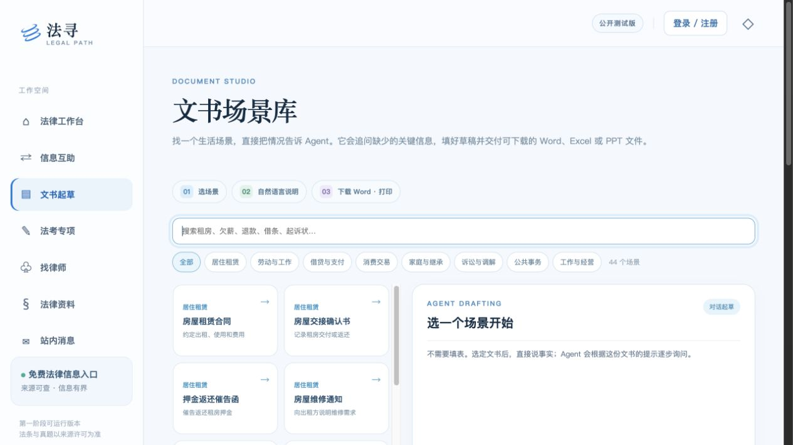
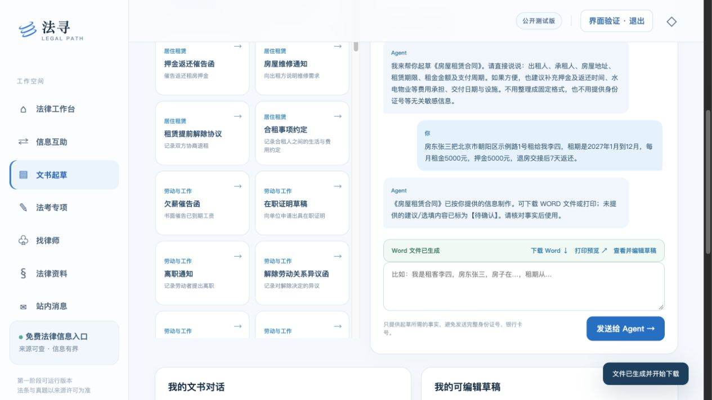
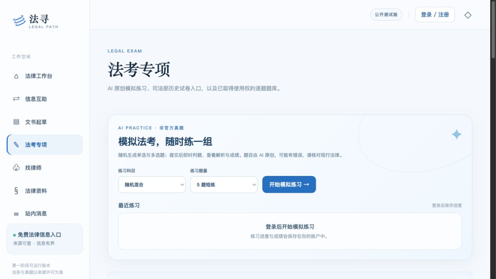
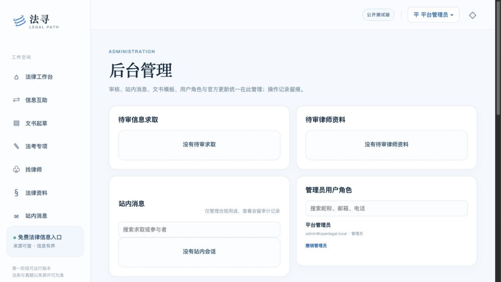

# 法寻 · 开放法律服务平台

中国大陆法律信息服务的第一阶段可运行版本。复用同级 `agent-foundation` 的模型配置、DeerFlow 适配与按用户隔离的 Wiki；产品 API、账号、审核和页面在本仓库独立实现。`financial-freedom` 只作为多模块产品规模的参照。

## 已实现

- 法律工作台：根据问题选择官方来源；配置模型后由 Agent 做来源导航与事实梳理。当前目录只有来源元数据，不宣称已经检索法条全文或实时案例。
- 法律资料：国家法律法规数据库、人民法院案例库、政务服务、企业公示和律师核验等官方入口检索；后台每日收录国务院政策发布、最高法典型案例发布页的标题和链接。
- 文书与 Office：44 个生活、劳动、借贷、消费、家事、诉讼、公共事务和经营场景。每个场景保存原创草稿和一段 Agent 提问提示，区分必填、非常建议及选填事实。用户通过聊天提供信息；Agent 追问缺项后生成可下载、打印的 Word、Excel 或 PPT。草稿按账号隔离，可继续编辑。
- 信息互助：发布信息求取、填写报酬意向、审核后公开、平台核验标签、求取方与提供者的站内会话。
- 律师：提交真实姓名、身份证明、执业证两页、执业信息及职业头像；管理员核验后公开主页、职业头像与匿名案例摘要。身份证与执业证图片只对本人和管理员开放。
- 法考专项：使用在线模型生成原创单选、多选模拟题，提交后即时判题并保存个人成绩；搜索 2013–2017 年司法部公开试卷与参考答案的官方目录链接；支持导入有明确使用权的逐题题库，再按题干、科目和年份检索。部分旧目录内链已失效。
- 管理后台：登录后从头像菜单进入，可审核信息互助与律师认证、查阅站内消息、增加对话式文书模板、管理用户角色、查看与手动执行官方目录同步。普通用户的头像菜单提供个人信息与密码管理。
- 多用户会话、CSRF 校验、按账号隔离的草稿和消息、审核与操作审计；用户表有邮箱唯一索引、角色/创建时间、昵称与电话索引，后台用户列表分页。

## 功能效果

截图来自本地运行页面，展示的是界面和示例数据；法律内容仍需以链接指向的官方原站为准。

**法律工作台**：描述问题，获取基于官方来源目录的下一步指引。


**文书场景库与对话起草**：选择场景后直接描述事实，Agent 追问缺项并生成可下载的 Office 文件。





**法考专项**：AI 模拟练习、历史试卷入口与司法部公告监测。



**后台管理**：从登录后的头像菜单进入，集中处理审核、角色、消息、模板和来源更新。



## 本地启动

需要 Python 3.12。以下命令在仓库根目录执行：

```bash
python3.12 -m venv .venv
.venv/bin/pip install -e .
cp .env.example .env
# 编辑 .env：填写在线模型名称、API 地址和 API Key 环境变量
PYTHONPATH=src APP_DATA_DIR=.runtime/data .venv/bin/uvicorn legal_service.app:app --host 127.0.0.1 --port 8788
```

打开 <http://127.0.0.1:8788>。未配置模型时，Agent 提供官方来源导航，AI 模拟出题不可用。请在私有 `.env` 中配置在线 OpenAI Chat Completions 兼容模型；密钥放在 `api_key_env` 指向的独立环境变量。服务启动时自动加载仓库根目录 `.env`，且不会覆盖进程已有的环境变量。法律工作台优先使用 DeerFlow；本地未安装其可选依赖时，使用同一在线模型配置直连生成回答，不需要本地模型。

Docker 启动使用在线模型：

```bash
./scripts/init.sh
# 编辑 .env，填写在线模型名称、端点和 API Key
./scripts/up.sh
```

`scripts/init.sh` 会创建仅本地保存的 `.env`。启动脚本只启动 API，不会拉取或运行 Ollama。容器端口只绑定 `127.0.0.1`。新环境的管理员账号在服务运行后创建：

```bash
APP_DATA_DIR=.runtime/data .venv/bin/legal-service bootstrap-admin --email admin@example.com
```

Docker 中可用 `docker compose exec api legal-service bootstrap-admin --email admin@example.com`。命令交互式读取密码，不回显；新部署不会预设通用管理员密码。管理员可在“个人信息管理”改密码。数据库位于 `APP_DATA_DIR/legal.sqlite3`；生产环境须另行配置 HTTPS、备份、监控、限流和运营审核。

## 官方更新与企业公示边界

运行中的 API 默认每小时检查是否已完成当天的官方目录同步，每个来源每天成功一次；启动后会补做当天尚未执行的检查。可设置 `APP_SYNC_ENABLED=false` 关闭内置任务，或使用 `legal-service sync-sources --force` 人工更新。当前源包括[国务院政策](https://www.gov.cn/zhengce/)、[司法部法律职业资格管理局](https://www.moj.gov.cn/jgsz/jgszjgtj/flzyzgglj/)和[最高人民法院典型案例发布](https://www.court.gov.cn/zixun/gengduo/104_3.html)。数据库保存标题、原站链接、收录时间和来源月份，不复制全文；条文效力、施行日期和案例裁判要旨仍需在原站确认。法考更新只监测公告，不把 AI 模拟题当官方真题，也不自动抓取受版权保护的试题。

企业注册信息入口指向[国家企业信用信息公示系统](https://www.gsxt.gov.cn/)。目前没有获授权的企业登记数据接口；官方系统的完整查询可能要求实名登录，因此平台不会伪造企业、股东或出资结果。`/api/v1/companies/search` 会返回明确的 `official_login_required` 状态与官方入口。接入获授权数据服务后，才可增加平台内的企业结果展示。具体限制见 [官方数据接入说明](docs/OFFICIAL_DATA.md)。

## 法考逐题数据导入

仓库只附官方链接元数据。逐题文本需由运营方先取得明确使用权，再用 JSONL 导入。每行一个 JSON 对象：

```json
{"paper":{"id":"licensed-2016-1","year":2016,"title":"已授权试卷","subject":"民法","paper_type":"客观题","source_url":"https://example.org/paper","authority":"授权方"},"question":{"number":"1","stem":"题干文本","options":["A. 选项"],"answer":"A","explanation":"解析","source_url":"https://example.org/question/1"}}
```

```bash
APP_DATA_DIR=.runtime/data .venv/bin/legal-service import-exam \
  --file /path/to/questions.jsonl \
  --rights-basis permission \
  --rights-evidence https://example.org/permission
```

`--rights-basis` 可用 `licensed`、`permission`、`public-domain`。系统记录来源与权利依据，但不会自动判断授权文件的真实性，导入前仍需人工核对。司法部的 2018 年起法考公告说明不公布试题及参考答案，因此不将“回忆版”标为官方真题。

## AI 模拟法考

登录后在“法考专项”选择科目与 5/10 题练习。题目由在线模型逐题原创生成，提交答案后由服务端核对保存的答案并显示解析；未作答题目的答案不会发给浏览器。每人每天最多生成 30 题。练习记录只对本人可见。AI 题目与解析可能有错误，页面提供国家法律法规数据库核对入口，不作为官方真题或法律意见。

## 文书与 Office 文件

在“文书场景库”搜索租房、欠薪、退款、借条、起诉状等场景，点击后直接向 Agent 描述情况，无需填写字段表单。每个场景在 `src/legal_service/document_scenarios.py` 保存草稿结构和 `intake_prompt`：列出必填、非常建议、选填信息，并要求只使用用户明确提供的事实。缺少必填信息时 Agent 继续追问；齐全后自动填好草稿并开始下载。未知的建议或选填信息以“【待确认】”保留。生成后可继续聊天补充，再次下载或打印。完整目录见[文书场景库说明](docs/DOCUMENT_LIBRARY.md)。

多数场景生成 DOCX；证据清单和费用台账生成 XLSX，案件沟通简报生成 PPTX。空白 Word、Excel、PPT 模板仍可直接下载。用户聊天内容会发送给 `.env` 配置的在线模型进行事实提取，原始对话和文件仅对本人可见。请勿提供与文书无关的身份证号、银行卡号等敏感信息。文书草稿并非律师审校成品，签署或提交前需核对事实、规则和受理机关要求。房屋租赁草稿可对照[市场监管总局示范文本](https://htsfwb.samr.gov.cn/View?id=2340996b-882d-47a4-b74d-c30784628737)审阅。

## 验证与设计文档

```bash
PYTHONPATH=src .venv/bin/python -m unittest discover -s tests -v
node --check web/app.js
```

- [功能规格](SPEC.md)
- [开源与数据源调研](OPEN_SOURCE_RESEARCH.md)
- [设计规范](DESIGN.md)与[交互约定](UX-CONTRACT.md)
- [实现范围与后续工作](docs/IMPLEMENTATION.md)
- [UI 验证记录](docs/UI_VERIFICATION.md)

`prototype/` 保留最初的静态 UI demo；运行产品页面位于 `web/`。
